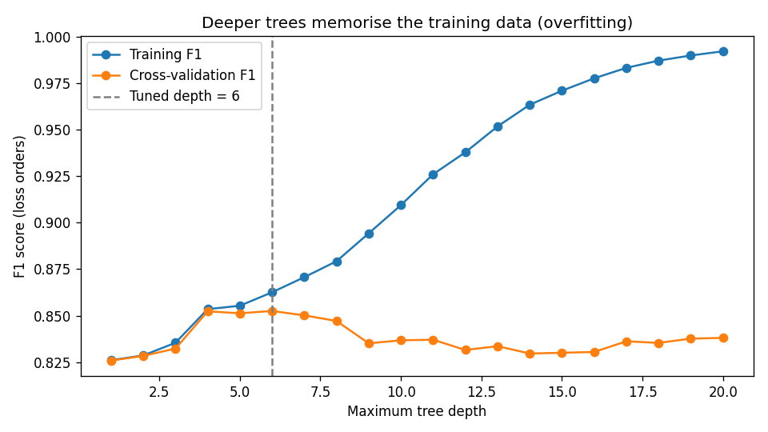
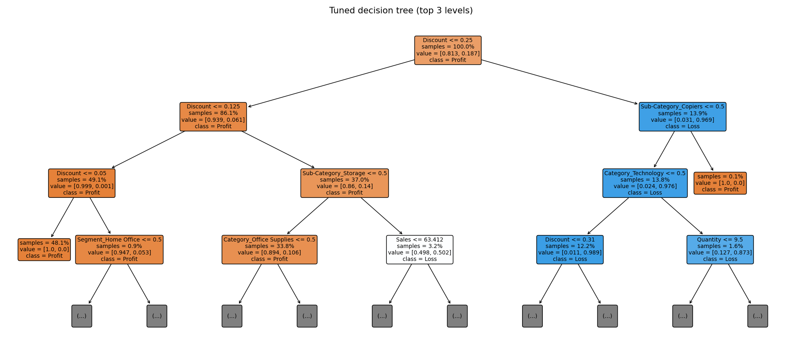
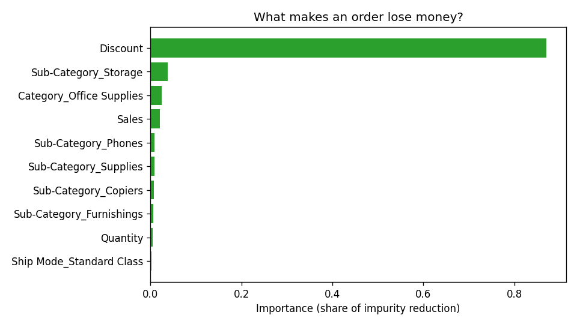
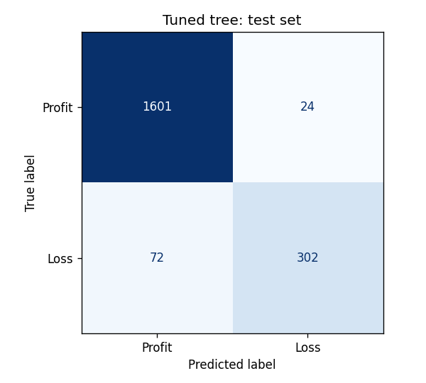

# 🌳 Decision Tree: Loss-Making Order Detector

  

Predicts whether a retail order will **lose money** *before* it ships, using only what's known when the order is placed: product, customer segment, region, shipping mode, sales value, quantity and discount. The tuned tree is small enough to read as **business rules**, and the app shows the exact questions the tree asked for each order.

## 🧠 How a Decision Tree works (plain English)

A decision tree is a **flowchart of yes/no questions** learned from data:

```
Is the discount > 25%?
├── Yes → Is it a copier? ─ No → 97% of these orders LOSE money
└── No  → Is the discount > 12.5%?
          ├── No  → almost always PROFITABLE
          └── Yes → Is it a storage product? …
```

- At each step, the tree picks the question that best **separates** loss orders from profitable ones (it measures this with *Gini impurity*: how mixed the groups are).
- It keeps splitting until it reaches a stopping rule, then each final box (*leaf*) gives a prediction.
- **The big risk is overfitting.** If a tree keeps splitting forever, it ends up memorising every training example, including the noise. It's like a student who memorises past exam answers instead of learning the subject.
- **The fix:** limit the depth, require a minimum number of examples per leaf, or *prune* weak branches (`ccp_alpha`). All three are tuned here with cross-validation.

## 📂 Dataset

**Superstore sales** (9,994 order lines, US retailer, 2014–2017), shared in [`../datasets/superstore.csv`](../datasets/).

- **Target:** `is_loss` = 1 if the order's profit is negative. **18.7%** of orders lose money.
- **Inputs:** `Ship Mode`, `Segment`, `Region`, `Category`, `Sub-Category` (one-hot encoded), plus `Sales`, `Quantity`, `Discount`.
- `Profit` itself is excluded from the inputs, since using the answer to predict the answer would be *data leakage*.

## ⚙️ Approach (`train.py`)

1. Stratified 80/20 train/test split, so both sets have the same loss rate.
2. **Pipeline**: `OneHotEncoder` for categories → `DecisionTreeClassifier`.
3. **Three models compared**:
   - Baseline: always predict "profitable"
   - **Unlimited tree**: no limits, grows until every leaf is pure
   - **Tuned tree**: `GridSearchCV` over 200 combinations of `max_depth`, `min_samples_leaf` and `ccp_alpha`, with 5-fold stratified CV, optimising **F1** (balances catching losses vs. false alarms)
4. An **overfitting curve** shows training vs. validation F1 for depths 1–20.
5. Charts, the tree's full rule set (`results/tree_rules.txt`) and metrics are saved.

## 📊 Results (test set: 1,999 orders)

| Model | Depth | Leaves | Train F1 | Test F1 | Precision | Recall | Accuracy | ROC-AUC |
|---|---|---|---|---|---|---|---|---|
| Baseline (always "profitable") | – | – | – | 0.000 | – | 0% | 81.3% | 0.500 |
| Unlimited tree | 24 | 429 | **0.999** | 0.829 | 82.2% | 83.7% | 93.5% | 0.897 |
| **Tuned tree** (depth 6) | **6** | **34** | 0.860 | **0.863** | **92.6%** | 80.7% | **95.2%** | **0.982** |

**The overfitting lesson:** the unlimited tree scores almost perfectly on data it has seen (train F1 0.999) but worse on new orders. The tuned tree is **12× smaller** (34 vs 429 leaves), easier to explain, and **better** on unseen data.



Training F1 keeps rising as the tree grows deeper, but validation F1 levels off around depth 6. Beyond that, the extra splits only memorise noise.





**The business insight:** `Discount` accounts for **87%** of the tree's decisions.

| Discount | Orders | Share that lose money |
|---|---|---|
| None | 4,798 | **0%** |
| 1–10% | 94 | 4% |
| 11–20% | 3,709 | 14% |
| 21–50% | 537 | **92%** |
| Over 50% | 856 | **100%** |

The first split, **"discount > 25%"**, sorts orders into two groups: above it, 97% lose money. Between 12.5% and 25%, the product matters: storage products, for example, are riskier. A simple pricing policy (cap discounts at 20%, and review storage discounts) would prevent most loss-making orders.



When the tuned tree flags an order as a loss, it's right **93%** of the time, and it catches **81%** of all loss-making orders.

## 🖥️ App (`app.py`)

Choose an order's details to see:

- whether it's **likely to lose money**, and the probability
- **"How the tree decided"**: the exact questions the tree asked for this order, e.g. `Discount = 0.8 → Discount > 0.25`, then `Sub-Category_Copiers? No` …

## 🚀 Run it

```bash
pip install -r requirements.txt
python train.py          # tune the tree, save charts, rules and metrics (~30 s)
python app.py            # open http://127.0.0.1:7860
python -m unittest -v    # 5 tests
```

## 📚 Key takeaways

- Decision trees are **interpretable**: you can print them as rules and explain every prediction.
- Unlimited trees **overfit**. Always limit or prune them, and choose the limit with cross-validation.
- A smaller tree can be both **simpler and more accurate** on new data.
- Accuracy alone is misleading with imbalanced classes: "always profitable" scores 81% accuracy but catches zero losses.
