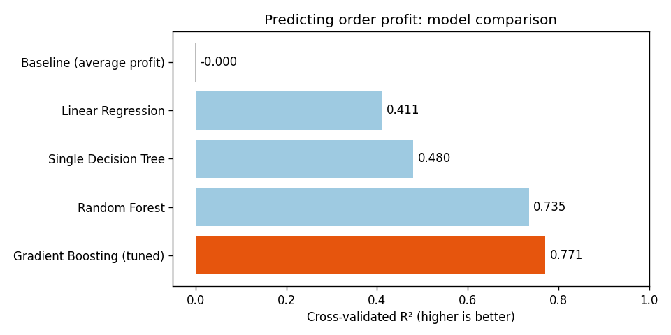
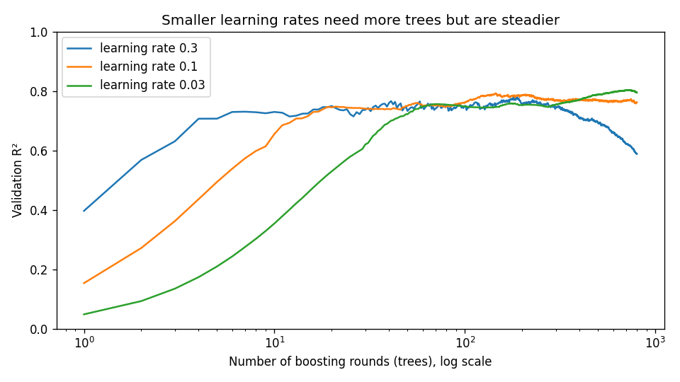
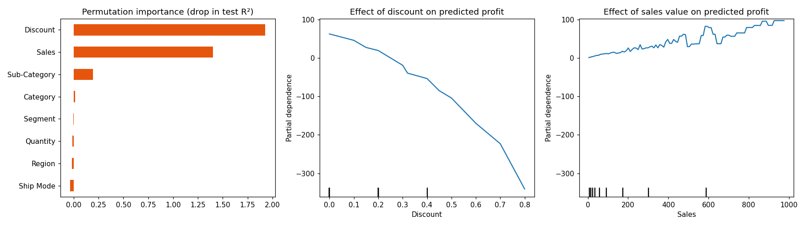
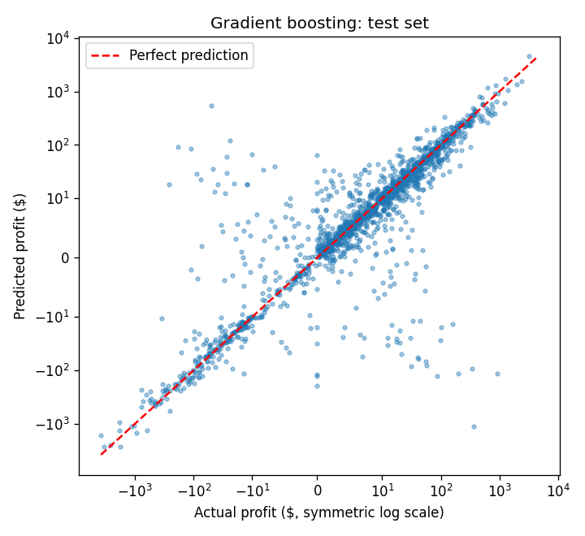

# 🚀 Gradient Boosting: Order Profit Predictor

  

Predicts the **profit in dollars** of each Superstore order from what's known when the order is placed. Gradient boosting is compared with linear regression, a single tree and a random forest, and comes out best: **CV R² 0.771 vs 0.411 for linear regression**. The project also shows how the **learning rate** and **number of trees** interact, why **R² can be wrecked by one extreme order**, and the app answers "what happens to profit if I change the discount?"

## 🧠 How Gradient Boosting works (plain English)

A [random forest](../Random%20forest/) builds many trees **independently** and averages them. Gradient boosting builds trees **one after another**, and each new tree tries to fix the mistakes left by all the previous ones:

```
Tree 1: predicts profit roughly          → errors left over (residuals)
Tree 2: learns to predict those errors   → add a small step of it   → smaller errors
Tree 3: learns the remaining errors      → add a small step          → smaller still
… hundreds of small corrections later → a very accurate model
```

- **Learning rate**: how big a step each tree takes. Small steps (0.03) need more trees but are steadier; big steps (0.3) learn fast but can overshoot and overfit.
- **Number of trees (`max_iter`)**: too few underfits, too many (with a high learning rate) overfits.
- **Tree size (`max_leaf_nodes`, `min_samples_leaf`)** and **`l2_regularization`** keep each correction simple.

Gradient boosting (XGBoost, LightGBM, CatBoost and scikit-learn's `HistGradientBoosting`) is the go-to algorithm for **tabular data** and wins many Kaggle competitions.

## 📂 Dataset

[Superstore orders](../datasets/) (9,994 order lines). The **target** is `Profit` in dollars: median **$8.67**, ranging from **−$6,600 to +$8,400**, with **18.7%** of orders losing money. Inputs: `Ship Mode`, `Segment`, `Region`, `Category`, `Sub-Category`, `Sales`, `Quantity`, `Discount`.

The very wide, heavy-tailed target makes this a hard regression problem: a few huge orders have profits hundreds of times larger than typical ones.

## ⚙️ Approach (`train.py`)

1. 80/20 train/test split.
2. **`HistGradientBoostingRegressor`** with native categorical support (no one-hot needed), tuned with `RandomizedSearchCV` over learning rate, number of trees, tree size, leaf size and L2 regularisation (12 combinations × 5 folds).
3. Compared with **4 other models** using 5-fold CV and the test set: average-profit baseline, linear regression, a single decision tree, and a random forest.
4. **Boosting-rounds experiment**: validation R² after every tree, for learning rates 0.3, 0.1 and 0.03.
5. **Explanation**: permutation importance and **partial dependence** (how predicted profit changes with discount and with sales, all else equal).

## 📊 Results

| Model | CV R² | CV MAE | Test R² | Test MAE | Test RMSE |
|---|---|---|---|---|---|
| Baseline (average profit) | 0.000 | $63.8 | −0.002 | $67.5 | $220.4 |
| Linear Regression | 0.411 | $56.9 | −0.646 | $67.8 | $282.5 |
| Single Decision Tree | 0.480 | $31.1 | −0.227 | $38.3 | $243.9 |
| Random Forest | 0.735 | **$20.8** | 0.087 | $27.8 | $210.4 |
| **Gradient Boosting (tuned)** | **0.771** | $21.5 | **0.793** | **$22.6** | **$100.1** |

Best settings: learning rate 0.2, 800 trees, 31 leaves per tree, `min_samples_leaf=5`, `l2_regularization=1.0`.



**Why do test R² scores swing so much? One order.** The test set contains the **largest sale in the whole dataset**: a $22,638 machine order (50% discount) that **lost $1,811**, far beyond anything in the training data.

| Model | Prediction for the $22,638 order |
|---|---|
| Linear Regression | **+$5,853** ❌ |
| Random Forest | **+$5,194** ❌ |
| **Gradient Boosting** | **−$2,751** ✅ (right direction) |

R² squares the errors, so a single $7,000 miss can outweigh 1,998 good predictions: the random forest's test R² falls to 0.09 even though its cross-validated R² is 0.735. **Lessons:** look at CV scores and MAE alongside R², always inspect your biggest errors, and expect models to struggle outside the range of their training data. Gradient boosting was the most robust: its biggest test error was an $8,000 order that lost $3,840, which it predicted as a $1,659 loss.



| Learning rate | Best round | Best validation R² | R² after 800 rounds |
|---|---|---|---|
| 0.3 | 188 | 0.780 | 0.588 (overfitting) |
| 0.1 | 145 | 0.793 | 0.762 |
| 0.03 | 735 | **0.804** | 0.795 |

A **high learning rate** peaks early and then overfits as more trees are added. A **low learning rate** climbs slowly but steadily to the best score.



- **Discount** and **sales value** dominate. Their permutation importances are above 1 because shuffling them makes predictions *worse than predicting the average* (R² goes negative).
- **Partial dependence of discount:** predicted profit falls steadily from about **+$60 at 0% to −$340 at 80%**, crossing zero at around **25–30%**. That's the same threshold the [Decision Tree](../Decision%20tree/) found for loss-making orders, now measured in dollars.



## 🖥️ App (`app.py`)

Describe an order to get:

- its **predicted profit** and margin
- a **"same order at different discounts"** line chart, and the discount at which this order starts **losing money**

Example: a $900 table order to a Central consumer becomes a loss from a **20% discount**, and at 40% it's predicted to lose **$332**.

## 🚀 Run it

```bash
pip install -r requirements.txt
python train.py          # tune, compare 5 models, boosting curves, explanations (~4 min)
python app.py            # open http://127.0.0.1:7860
python -m unittest -v    # 5 tests (~4 min)
```

## 📚 Key takeaways

- Boosting = **many small trees, each fixing the previous trees' errors**. It's the strongest default for tabular data.
- **Learning rate × number of trees** is the key trade-off: lower rates need more trees but generalise better.
- **R² is fragile with heavy-tailed targets**: report MAE and CV scores, and check your largest errors.
- Use **partial dependence** to turn a black-box model into business answers ("profit turns negative above ~25% discount").
