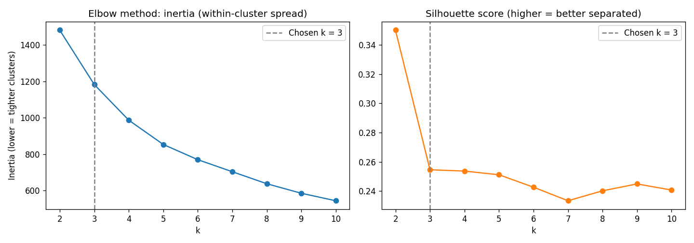
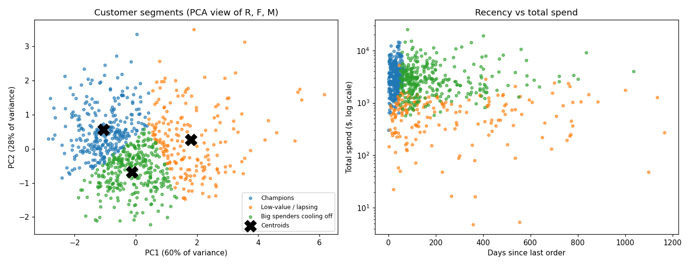
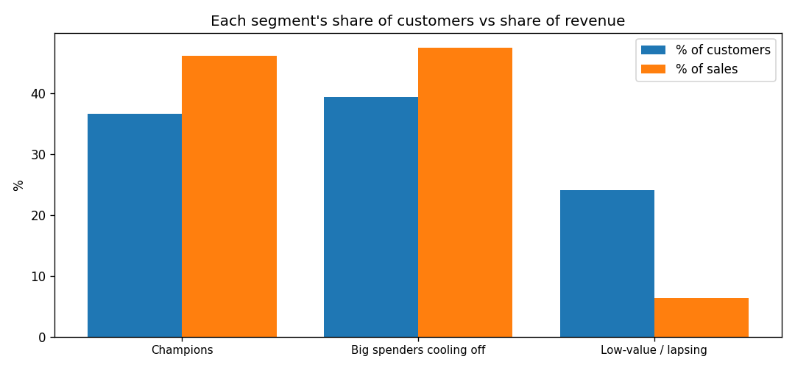

# 🛒 K-Means Clustering: Customer Segmentation (RFM)

  

Groups **793 Superstore customers** into segments by how **recently** they bought, how **often** they buy and how much they **spend** (RFM). Nobody tells the algorithm what the groups should be. It discovers them, and the project turns each one into a named segment with a marketing action.

## 🧠 How K-Means works (plain English)

K-Means is **unsupervised**: there are no labels or right answers, just data to organise.

1. Choose **k**, the number of groups.
2. Place **k centre points** (*centroids*) at random.
3. **Assign** every customer to their nearest centre.
4. **Move** each centre to the average of its customers.
5. Repeat steps 3–4 until the centres stop moving.

```
start: ✖ random centres   →   assign   →   move centres   →   … converged ✔
```

**How do you choose k?**
- **Elbow method**: plot *inertia* (how spread out customers are around their centre) for each k and look for the "elbow" where adding clusters stops helping much.
- **Silhouette score** (−1 to 1): for each customer, how much closer they are to their own cluster than to the next nearest one. Higher means better-separated clusters.

**Gotchas handled here:** K-Means uses distances, so features must be **scaled**. Spend and order counts are **heavily skewed** (a few customers spend 100× more than others), so they're **log-transformed** first. Otherwise the big spenders would dominate everything.

## 📂 Data: building RFM features

From the [Superstore orders](../datasets/) (9,994 order lines, 2014–2017), each customer gets three numbers:

| Feature | Meaning | Median | Range |
|---|---|---|---|
| **R**ecency | Days since their last order (vs. the day after the last order in the data) | 76 days | 1 – 1,166 |
| **F**requency | Number of separate orders | 6 | 1 – 17 |
| **M**onetary | Total spend | $2,256 | $5 – $25,043 |

## ⚙️ Approach (`train.py`)

1. Aggregate orders into one RFM row per customer.
2. **Pipeline**: `log1p` → `StandardScaler` → `KMeans` (20 random restarts to avoid bad starting centres).
3. Compute **inertia** and **silhouette** for k = 2…10.
4. Choose k: the best silhouette among 3–5. (k = 2 always scores highest, but "good vs bad customers" is too coarse to act on.)
5. Profile each cluster (median R, F, M; share of customers vs. share of revenue; total profit) and **name** it automatically from its R/F/M ranking.
6. Save every customer's segment to `results/customer_segments.csv`.

## 📊 Results



| k | 2 | 3 | 4 | 5 | 6 | 8 | 10 |
|---|---|---|---|---|---|---|---|
| Silhouette | 0.350 | **0.255** | 0.254 | 0.251 | 0.243 | 0.240 | 0.241 |

**Chosen: k = 3.** The elbow is gentle and silhouette scores of about 0.25 are modest. That's an honest and common finding for real customers: they form a **continuum** rather than neat separate blobs, so the segments are useful summaries with fuzzy edges.

**The three segments:**

| Segment | Customers | Last order (median) | Orders (median) | Spend (median) | % of customers | % of sales | Total profit |
|---|---|---|---|---|---|---|---|
| 🏆 **Champions** | 290 | 28 days ago | 8 | $3,058 | 36.6% | 46.1% | $137,509 |
| ⏳ **Big spenders cooling off** | 312 | 122 days ago | 6 | $2,759 | 39.3% | 47.5% | $137,323 |
| 💤 **Low-value / lapsing** | 191 | 159 days ago | 4 | $736 | 24.1% | 6.4% | $11,565 |





**Business insights:**
- **Champions** buy often and recently: 37% of customers bring in 46% of sales.
- **Big spenders cooling off** are the key finding. They spend almost as much as Champions and generate the **same total profit** ($137K), but their last order was about 4 months ago. They're the most valuable group to **win back** before they drift into the lapsing segment.
- **Low-value / lapsing**: a quarter of customers but only 6% of sales. They're not worth expensive retention discounts (and the [Decision Tree project](../Decision%20tree/) showed heavy discounts lose money anyway).

## 🖥️ App (`app.py`)

- Shows the table of segments K-Means discovered.
- Enter a customer's **recency, frequency and spend** to get their **segment**, a typical profile, a **suggested marketing action**, and their **distance to every segment centre**.

## 🚀 Run it

```bash
pip install -r requirements.txt
python train.py          # build RFM, choose k, profile segments (~5 s)
python app.py            # open http://127.0.0.1:7860
python -m unittest -v    # 5 tests
```

## 📚 Key takeaways

- K-Means finds groups **without labels**; you have to **interpret** and name them yourself.
- **Scale** the features, and **log-transform skewed** ones, or a single feature dominates the distances.
- Choose k with the **elbow** and **silhouette**, plus business sense: the "best" k is the one you can act on.
- Low silhouette scores don't mean failure. Real customers often lie on a **continuum**.
