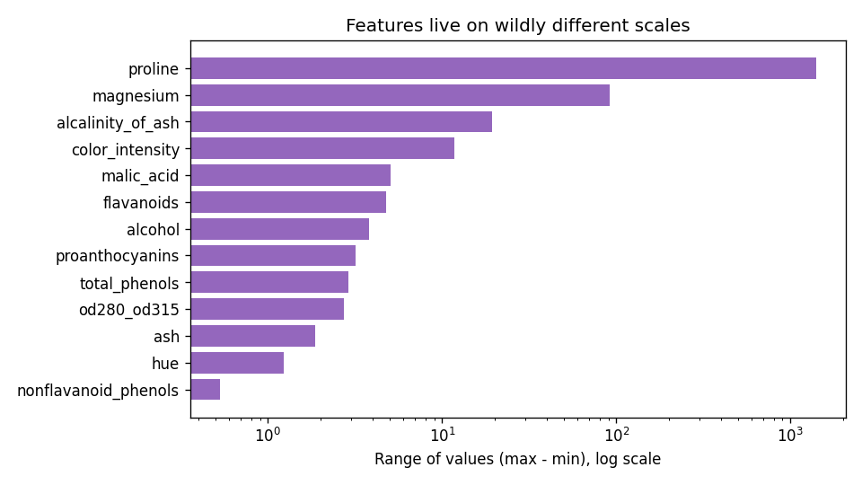
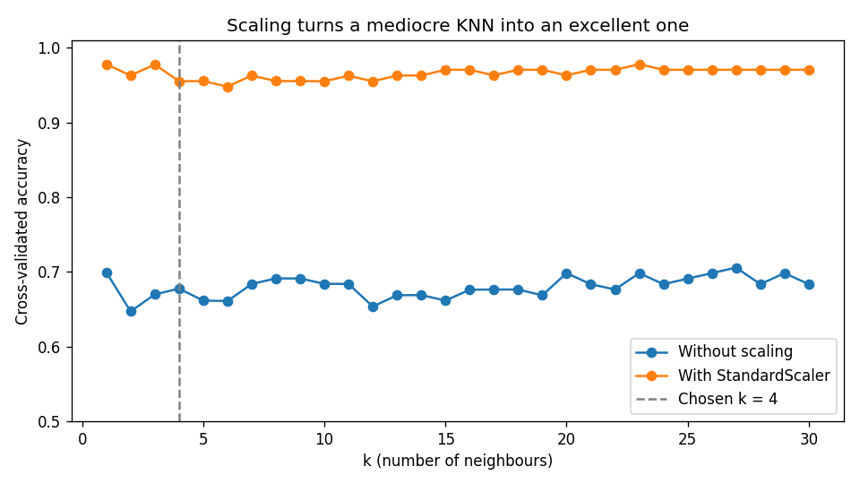
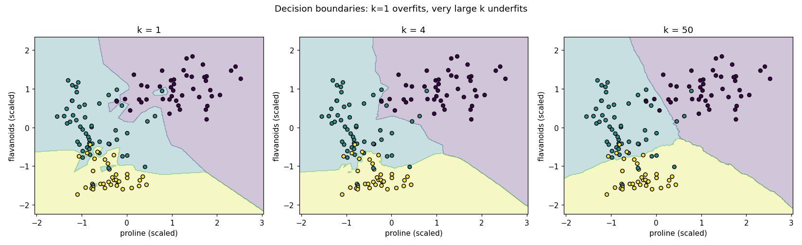
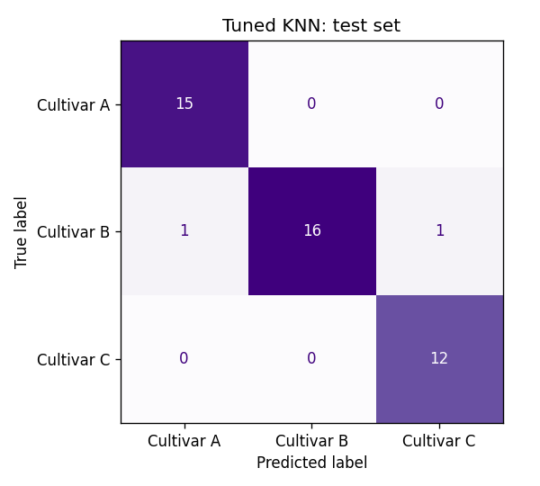

# 🍷 K-Nearest Neighbors: Wine Cultivar Classifier

  

Identifies which of **three grape cultivars** a wine came from using 13 chemical measurements. The project shows the most important lesson about KNN: **without feature scaling it's mediocre (78% test accuracy); with scaling it's excellent (96%)**. The app shows the actual neighbouring wines that voted on each prediction.

## 🧠 How KNN works (plain English)

KNN is the "you are who your neighbours are" algorithm:

1. Store every training example (no real "training" happens).
2. For a new wine, measure its **distance** to every stored wine.
3. Take the **k closest** wines and let them **vote** on the answer.

```
New wine ●   nearest 4 neighbours: C, C, C, B   →  predict C
```

**The catch: distance depends on units.** `proline` ranges over **1,402** units, while `hue` ranges over just **1.23**. Without scaling, a difference of 1 in proline counts as much as a difference of 1 in hue, so proline completely dominates the distance and the other 12 measurements are almost ignored. `StandardScaler` puts every feature on the same scale (mean 0, standard deviation 1), so each one gets a fair say.



**Choosing k:**

| k | Behaviour |
|---|---|
| Small (k = 1) | Follows every single point, so noisy, jagged boundaries (overfitting) |
| Large (k = 50) | Averages over huge regions, so boundaries are too smooth (underfitting) |
| Tuned | Chosen by cross-validation |

Other settings tuned here: the **distance metric** (Euclidean "straight line" vs Manhattan "city blocks") and **vote weighting** (all neighbours equal vs closer neighbours count more).

## 📂 Dataset

The **Wine dataset** (UCI), built into scikit-learn: **178 wines** from three cultivars grown in the same region of Italy (59 / 71 / 48), with **13 chemical measurements** each: alcohol, malic acid, ash, alkalinity, magnesium, phenols, flavanoids, colour intensity, hue, proline and more.

## ⚙️ Approach (`train.py`)

1. Stratified 75/25 train/test split.
2. **Scaling experiment**: 5-fold CV accuracy for k = 1…30, with and without `StandardScaler`.
3. **Tuning**: `GridSearchCV` over 30 k values × 2 distance metrics × 2 weighting schemes (120 combinations).
4. Test-set comparison against a "most common cultivar" baseline.
5. Decision-boundary plots for k = 1, the tuned k, and k = 50.

## 📊 Results

| Model | CV accuracy | Test accuracy | Test macro-F1 |
|---|---|---|---|
| Baseline (most common cultivar) | – | 40.0% | 0.190 |
| KNN **without** scaling (best k = 27) | 70.6% | 77.8% | 0.779 |
| **KNN with scaling, tuned** (k = 4, Manhattan, distance-weighted) | **99.3%** | **95.6%** | **0.956** |



**Scaling wins for every single value of k**, by about 25–30 percentage points. Without scaling, KNN mostly compares wines by proline alone. With scaling, all 13 measurements contribute, and the cultivars separate cleanly.



Using just two features, you can see the bias-variance trade-off. **k = 1** draws islands around individual points, **k = 50** blurs the boundary between cultivars, and the tuned **k = 4** sits in between.



On the 45 test wines, the tuned model makes only 2 mistakes.

## 🖥️ App (`app.py`)

Set the 13 measurements (or click an example) to see:

- the **predicted cultivar** and the vote share for each cultivar
- the **4 nearest training wines**: their distance, cultivar, alcohol and proline, so you can see exactly *who* voted

## 🚀 Run it

```bash
pip install -r requirements.txt
python train.py          # scaling experiment, tuning, charts (~15 s)
python app.py            # open http://127.0.0.1:7860
python -m unittest -v    # 4 tests
```

## 📚 Key takeaways

- KNN has no training step: it **memorises** the data and compares at prediction time (slow on very large datasets).
- **Always scale features** for distance-based models (KNN, K-Means, SVM).
- **k controls the bias-variance trade-off**; pick it with cross-validation.
- KNN is **naturally explainable**: you can show the actual examples behind every prediction.
