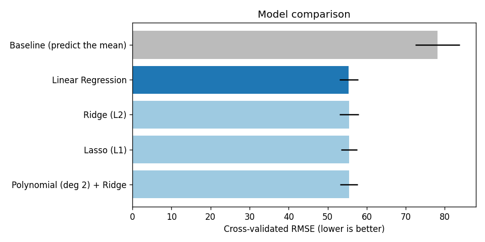
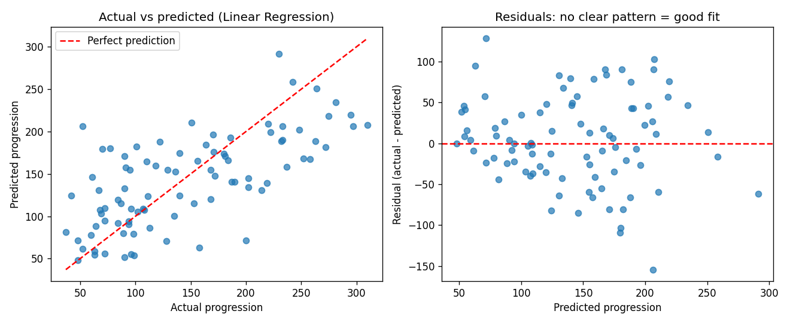
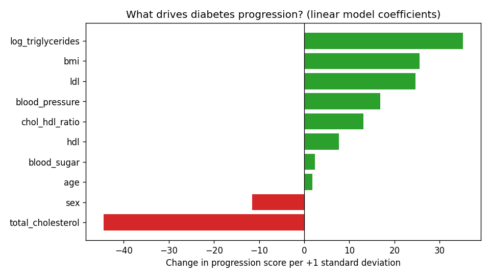

# 📈 Linear Regression: Diabetes Progression Predictor

  

Predicts how much a patient's diabetes will progress over the next year from 10 measurements taken today (age, BMI, blood pressure and six blood tests). The project compares plain Linear Regression with **Ridge**, **Lasso** and a **polynomial** model, chooses the best one with cross-validation, and explains each prediction.

## 🧠 How Linear Regression works (plain English)

Imagine plotting BMI against disease progression: the dots roughly go up together. Linear regression draws the **best straight line** through those dots:

```
progression = w₁ × bmi + w₂ × blood_pressure + … + w₁₀ × blood_sugar + b
```

- Each **weight** (w) says how much the prediction changes when that feature goes up by one unit.
- "Best" means the line that makes the **squared errors** between predictions and real values as small as possible (*ordinary least squares*).
- With 10 features it's a flat surface in 10 dimensions instead of a line, but the idea is the same.

**Regularisation: stopping the model from over-reacting**

| Variant | What it adds | Effect |
|---|---|---|
| **Ridge (L2)** | A penalty on *large* weights | Shrinks all weights a little; helps when features are correlated |
| **Lasso (L1)** | A penalty on the *size* of weights | Can shrink weights to exactly **zero**, which removes useless features |
| **Polynomial** | Adds squared and interaction terms (bmi², bmi × bp, …) | Lets a "linear" model bend into curves |

The penalty strength (`alpha`) is chosen automatically with `GridSearchCV`.

## 📂 Dataset

The **Diabetes dataset** (Efron et al., 2004), built into scikit-learn: **442 patients**, 10 baseline features, and a target that measures disease progression one year later (from 25, mild, to 346, severe).

| Feature | Meaning |
|---|---|
| `age`, `sex`, `bmi`, `blood_pressure` | Basic patient measurements |
| `total_cholesterol`, `ldl`, `hdl`, `chol_hdl_ratio` | Cholesterol blood tests |
| `log_triglycerides`, `blood_sugar` | Other blood tests |

## ⚙️ Approach (`train.py`)

1. **80/20 train/test split**: the test set is never used for any decision.
2. Every model is a **Pipeline** (`StandardScaler` → model), so scaling is learned only from training data, with no data leakage.
3. **5-fold cross-validation** on the training set compares 5 models, including a "predict the average" baseline.
4. Ridge, Lasso and Polynomial models tune `alpha` over 25 values with an inner `GridSearchCV`.
5. The model with the lowest cross-validated RMSE is chosen, then evaluated **once** on the test set.
6. Charts, the model and `results/metrics.json` are saved.

## 📊 Results

| Model | CV RMSE | Test R² | Test RMSE |
|---|---|---|---|
| Baseline (predict the mean) | 78.1 | −0.01 | 73.2 |
| **Linear Regression (chosen)** | **55.4** | **0.453** | **53.9** |
| Ridge (L2) | 55.5 | 0.460 | 53.5 |
| Lasso (L1) | 55.5 | 0.471 | 52.9 |
| Polynomial (deg 2) + Ridge | 55.4 | 0.459 | 53.5 |



**What the results mean:**

- The model explains about **45% of the variation** in disease progression and cuts the error by about 30% compared with guessing the average. That's typical for this dataset: one-year progression depends on many things that weren't measured (diet, medication, genetics).
- **All four models score almost the same.** With only 10 features and 442 patients, the relationship is mostly linear, so extra complexity (polynomials) and regularisation add little. Cross-validation picked the simplest model, which is the right call.
- **Lasso removed 3 features** (`age`, `ldl`, `chol_hdl_ratio`) and still scored as well, which shows they add little beyond the other features.



The residuals (errors) are scattered randomly around zero with no curve or funnel shape. That's the sign a linear model is appropriate.



**Reading the coefficients:** higher **triglycerides**, **BMI** and **blood pressure** predict faster progression, which matches medical knowledge. The large *negative* weight on `total_cholesterol` next to a large *positive* weight on `ldl` is a classic case of **multicollinearity**: the two are strongly correlated, so the model splits their effect in odd ways. Individual weights of correlated features shouldn't be read on their own, and that's exactly the problem Ridge and Lasso are designed to calm down.

## 🖥️ App (`app.py`)

Move the sliders for a patient's measurements to get:

- the **predicted progression score**, and whether it's lower, typical or higher than most patients
- the **top 5 factors** pushing this patient's score up or down

## 🚀 Run it

```bash
pip install -r requirements.txt
python train.py          # train, compare models, save charts + metrics
python app.py            # open http://127.0.0.1:7860
python -m unittest -v    # 5 tests
```

## 📚 Key takeaways

- Always compare against a **baseline**; a model is only useful if it beats "predict the average".
- Choose models with **cross-validation**, not the test set.
- **Regularisation** (Ridge/Lasso) matters most when features are many or correlated; here it mainly helped identify the features that matter.
- Coefficients are easy to read, but **correlated features** make individual weights misleading.

⚠️ Educational project only, not medical advice.
