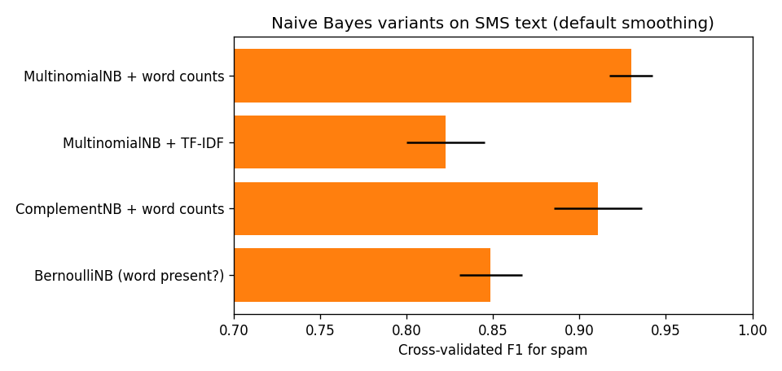
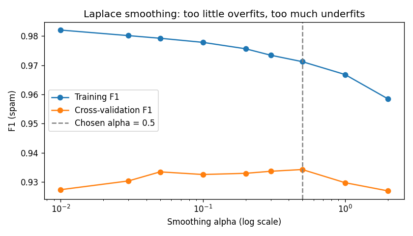
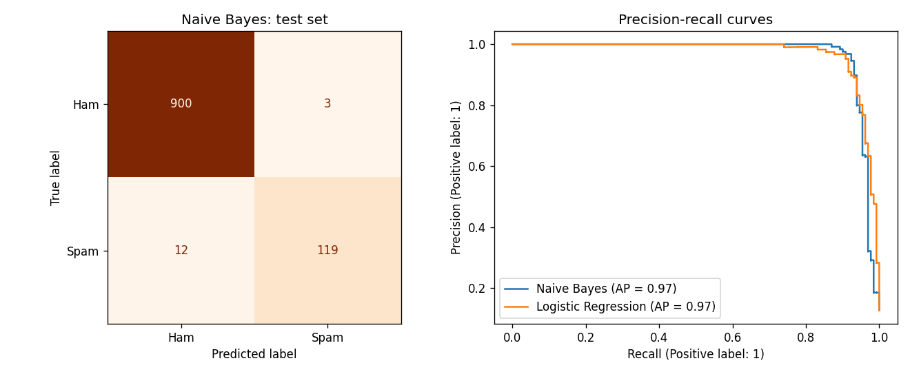
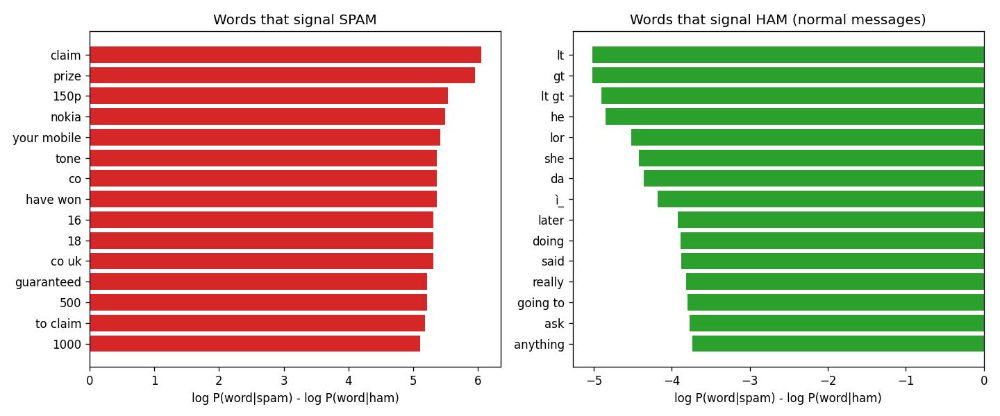

# 📱 Naive Bayes: SMS Spam Filter

  

Classifies text messages as **spam** or **ham** (normal messages) using word counts and Bayes' theorem. The project compares three Naive Bayes variants, tunes smoothing, benchmarks against logistic regression, and looks at the messages that fool the filter. The app highlights the exact words that tipped each decision.

## 🧠 How Naive Bayes works (plain English)

Naive Bayes learns how often each word appears in spam vs normal messages, then combines that evidence:

```
P(spam | "claim your prize") ∝ P(spam) × P("claim" | spam) × P("your" | spam) × P("prize" | spam)
```

- **Bayes' theorem** turns "how likely is this word in spam?" into "how likely is this message spam, given its words?"
- It's **"naive"** because it assumes words are independent of each other ("prize" and "claim" are treated as unrelated clues). That's clearly not true, yet it works remarkably well for text.
- **Smoothing (`alpha`)**: a word never seen in spam during training would get probability 0 and veto everything. Adding a small `alpha` to every count (*Laplace smoothing*) prevents that.

| Variant | Uses | Best for |
|---|---|---|
| **MultinomialNB** | How many times each word appears | Text with word counts |
| **ComplementNB** | Statistics from the *other* classes | Imbalanced text data |
| **BernoulliNB** | Only whether each word is present (yes/no) | Very short texts, binary features |

Why it's popular: it trains in **milliseconds**, needs little data, and its reasoning is easy to inspect.

## 📂 Dataset

**SMS Spam Collection** ([`../datasets/sms_spam.csv`](../datasets/)): 5,572 real SMS messages labelled spam or ham.

**Cleaning:**
- Some messages contained commas and spilled into extra CSV columns; they're stitched back together.
- **403 duplicate messages removed**, leaving 5,169. Without this, identical messages could land in both train and test sets and inflate the scores (*data leakage*).
- **12.6%** of messages are spam.

## ⚙️ Approach (`train.py`)

1. Stratified 80/20 split.
2. Text becomes numbers with `CountVectorizer`: lowercase, single words **and** two-word phrases ("have won", "your mobile"), keeping terms that appear at least twice, for a 10,083-term vocabulary.
3. **Compare 4 setups** with 5-fold CV (F1 for spam): Multinomial with counts, Multinomial with TF-IDF, Complement and Bernoulli.
4. **Tune `alpha`** for the winner over 9 values.
5. Benchmark on the test set against a "never spam" baseline and **logistic regression with TF-IDF**.
6. Extract the most spam-like and ham-like words, plus error examples.

## 📊 Results

**Which Naive Bayes variant?** (5-fold CV F1)

| Setup | CV F1 |
|---|---|
| **MultinomialNB + word counts** | **0.930 ± 0.013** |
| ComplementNB + word counts | 0.911 ± 0.026 |
| BernoulliNB (word present?) | 0.849 ± 0.018 |
| MultinomialNB + TF-IDF | 0.823 ± 0.023 |

Multinomial NB works best with **raw counts**, which is what its probability model expects. TF-IDF rescales counts in a way that breaks those assumptions, even though TF-IDF helps many other models.



**Test set** (1,034 messages, about 131 spam), with `alpha = 0.5`:

| Model | Precision | Recall | F1 | Accuracy | Avg. precision |
|---|---|---|---|---|---|
| Baseline (always ham) | – | 0% | 0.000 | 87.3% | 0.127 |
| **Naive Bayes (tuned)** | **97.5%** | 90.8% | **0.941** | **98.5%** | 0.966 |
| Logistic Regression + TF-IDF | 96.7% | 90.8% | 0.937 | 98.5% | 0.971 |

- The filter catches about **91% of spam**. When it says "spam", it's right **97.5%** of the time: only **3 normal messages** out of about 900 were blocked.
- **Naive Bayes matches logistic regression**, while being simpler and faster to train.







**Spam words** are what you'd expect: *claim*, *prize*, *150p*, *have won*, *your mobile*, *tone*, *co uk*, *18*. **Ham words** are conversational: *I'm*, *my*, *ok*, *lol*, *later*.

**Error analysis: what fools the filter?**
- **Missed spam** often reads like a normal message: quiz-style texts ("In The Simpsons Movie released in July 2007 name the band…"), or adult and dating spam written in casual personal language. They contain few classic spam words.
- **False alarms** are short messages that happen to use spammy words ("Nokia phone is lovly..") or sound like a sales pitch (a farm tour "great deal" with prices and a deposit).

## 🖥️ App (`app.py`)

Paste any message to see:

- **SPAM / Not spam** with a probability
- a table of the **most influential words and phrases** in that message and how strongly each one pointed towards spam (+) or ham (−)

## 🚀 Run it

```bash
pip install -r requirements.txt
python train.py          # compare variants, tune alpha, charts (~12 s)
python app.py            # open http://127.0.0.1:7860
python -m unittest -v    # 5 tests
```

## 📚 Key takeaways

- Naive Bayes is a fast, strong **baseline for text classification**, and often hard to beat.
- Match the variant to the data: **Multinomial for counts**, Bernoulli for presence/absence.
- **Remove duplicates** before splitting text data, or test scores will be too optimistic.
- For spam filtering, **precision matters**: blocking a real message is worse than letting one spam through.
