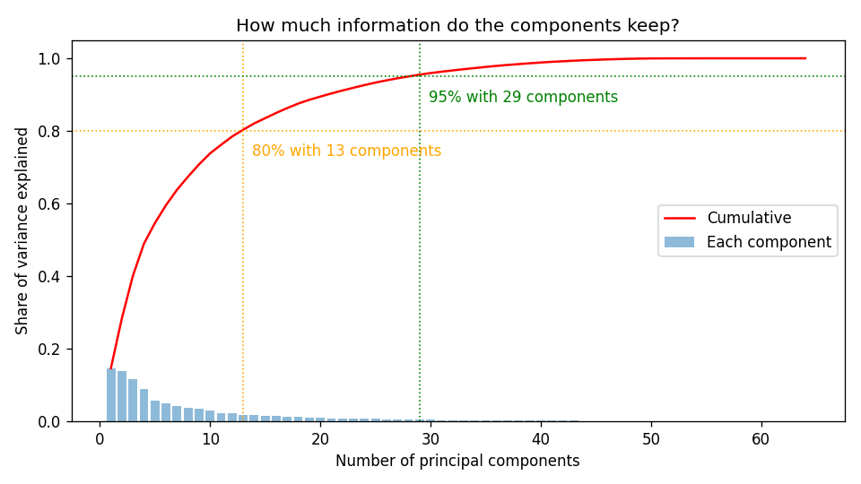
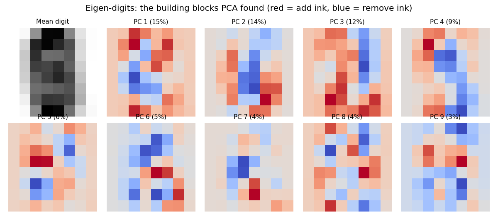
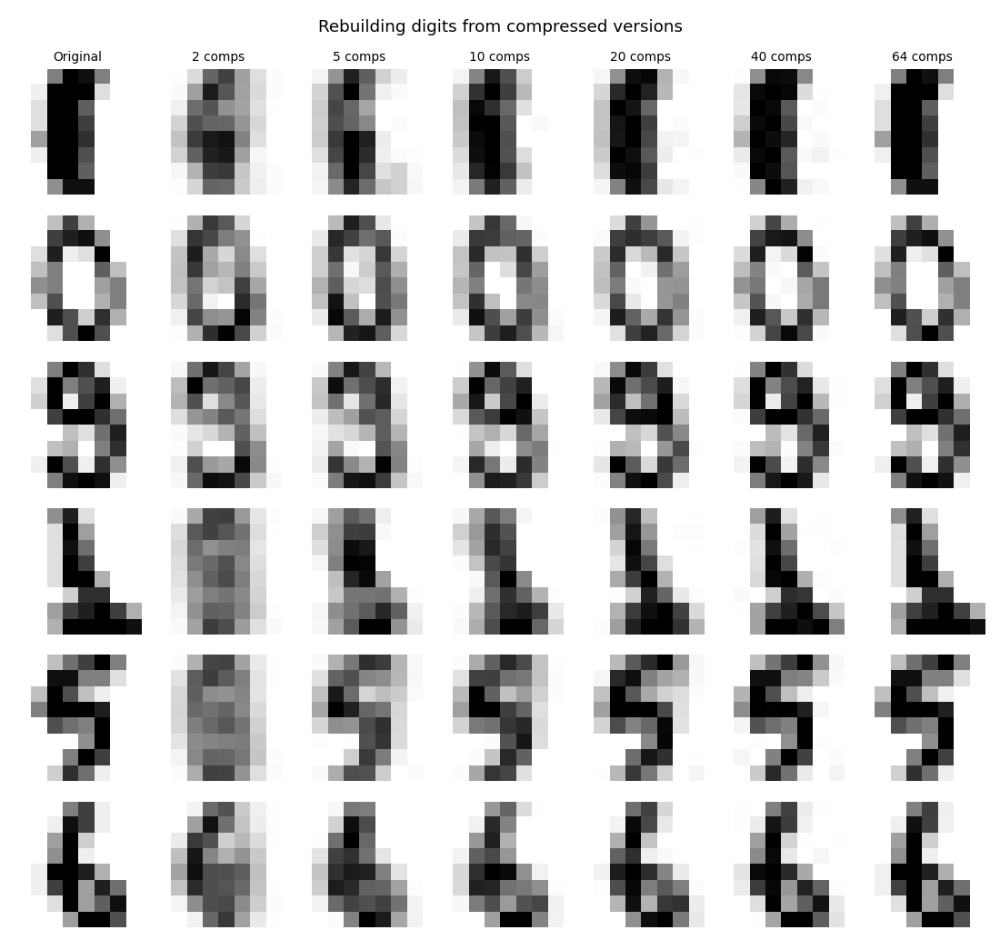
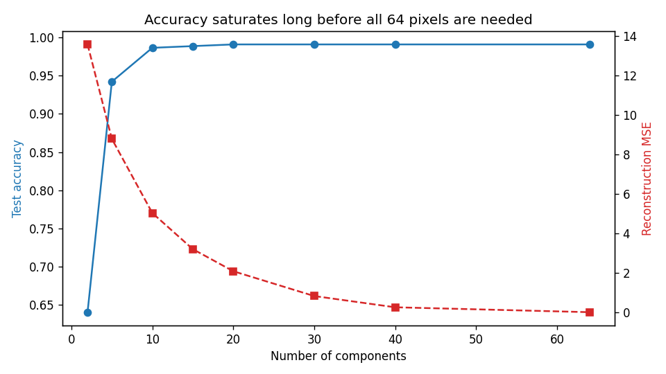
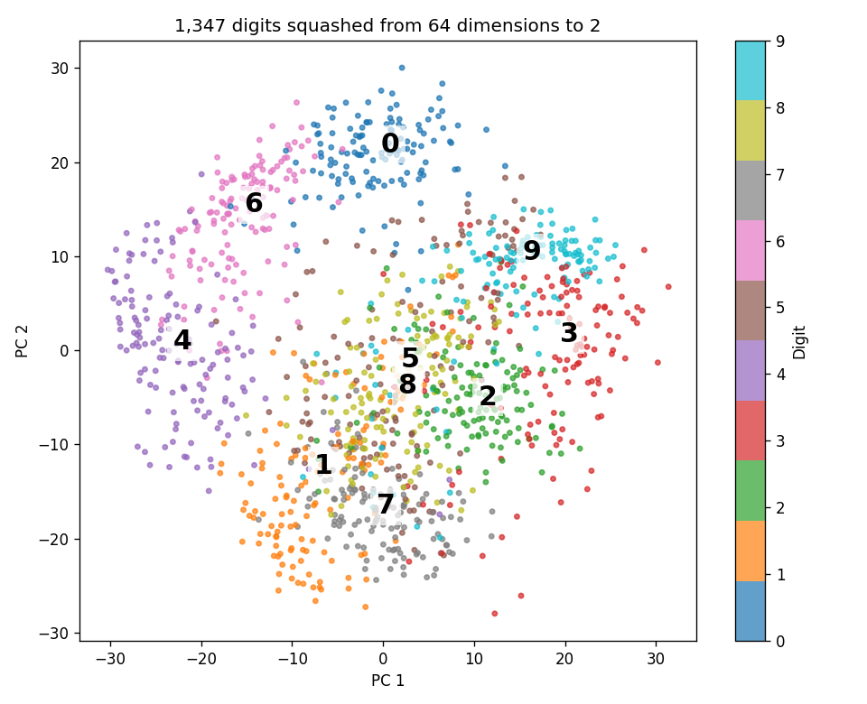

# 🔢 PCA: Handwritten Digit Compression & Visualisation

  

Uses **Principal Component Analysis (PCA)** to compress 8×8 handwritten digit images (64 pixels each) into a handful of numbers, then shows what's kept and what's lost. **Just 20 numbers per image give the same 99.1% classification accuracy as all 64 pixels.** The app lets you choose how many components to keep and watch a digit get rebuilt.

## 🧠 How PCA works (plain English)

Every digit image is 64 numbers (one per pixel). But pixels aren't independent: if the top-left pixel is dark, its neighbours probably are too. PCA finds a smaller set of **new axes** that capture most of the variation:

1. Find the direction in which the data **varies the most**. That's **principal component 1** (PC 1).
2. Find the next direction of greatest variation that's **perpendicular** to PC 1. That's PC 2.
3. Repeat. Each component captures less variation than the one before.
4. **Keep only the first few** components and drop the rest. That's the compression.

```
64 pixels  →  PCA  →  first 10 components (6.4× smaller)  →  rebuild  →  64 pixels (approximately)
```

Each component is itself an image: an **"eigen-digit"**. Every digit can be written as *the average digit + a mix of eigen-digits*.

**What PCA is used for:**
- **Compression**: store fewer numbers.
- **Visualisation**: squash many dimensions into 2D to plot them.
- **Faster, less noisy models**: train on the top components instead of all raw features.

## 📂 Dataset

The **UCI handwritten digits** dataset, built into scikit-learn: **1,797 images** of digits 0–9, each 8×8 pixels with ink levels 0–16. Split 75/25 (1,347 train / 450 test).

## ⚙️ Approach (`train.py`)

1. Fit PCA on the training images. Pixels already share one scale (0–16), so no standardising; scaling would amplify noise in the nearly empty edge pixels.
2. Measure the **explained variance**: how many components keep 50 / 80 / 90 / 95 / 99% of the information.
3. Visualise the **eigen-digits** (top 9 components).
4. **Rebuild** test digits from 2, 5, 10, 20, 40 and 64 components and measure the reconstruction error.
5. Train an **SVM classifier on 2…64 components** to see how much compression costs.
6. Final model: PCA keeping **95% of the variance** → SVM.

## 📊 Results

**How many components do you need?**

| Information kept | Components | Compression |
|---|---|---|
| 50% | 5 | 12.8× |
| 80% | 13 | 4.9× |
| 90% | 21 | 3.0× |
| **95%** | **29** | **2.2×** |
| 99% | 41 | 1.6× |



The first two components alone carry about 28% of all the variation; the last 20 components together carry under 1%.



The eigen-digits look like ghostly strokes. Adding or subtracting these patterns from the average digit builds every image. The 2D map further down shows what the first two capture: **PC 1** separates 4s and 6s (left) from 3s and 9s (right), and **PC 2** separates 0s (top) from 1s and 7s (bottom).



With 2 components every digit is a blur. By **10** they're recognisable, and by **20–30** they're nearly identical to the originals.

**Does compression hurt a classifier?** (SVM, test accuracy)

| Components | 2 | 5 | 10 | 15 | 20 | 30 | 64 (all pixels) |
|---|---|---|---|---|---|---|---|
| Accuracy | 64.0% | 94.2% | 98.7% | 98.9% | **99.1%** | 99.1% | 99.1% |
| Reconstruction MSE | 13.59 | 8.80 | 5.03 | 3.20 | 2.08 | 0.82 | 0.00 |



**10 components (6.4× compression) already give 98.7% accuracy, and 20 components match the full 64 pixels exactly.** The discarded components are mostly noise and tiny stroke variations that don't help tell digits apart. The final model (PCA at 95% variance = 29 components → SVM) reaches **99.1%** test accuracy.



Squashed from 64 dimensions to just **2**, the digits already form visible groups: 0, 4 and 6 sit apart on their own, while 1/7 and 5/8 overlap. That shows which digits are genuinely similar.

## 🖥️ App (`app.py`)

1. Choose a test image and the **number of components** to keep (1–64).
2. See the **original** next to the **rebuilt** image, plus the compression ratio, how much information is kept, the reconstruction error, and whether the classifier can still read the rebuilt digit.

Example: the first test image (a "1") rebuilt from **2 components** is read as a "4" ❌, but from **10 components** it's correctly read as a "1" ✅.

## 🚀 Run it

```bash
pip install -r requirements.txt
python train.py          # variance, eigen-digits, reconstructions, classifier sweep (~5 s)
python app.py            # open http://127.0.0.1:7860
python -m unittest -v    # 5 tests
```

## 📚 Key takeaways

- PCA finds new axes ordered by **how much variation** they explain, and you keep the top few.
- Real data is often **far simpler than its raw dimensions** suggest: 64 pixels → 20 numbers with no loss of accuracy.
- Use the **explained-variance curve** to choose how many components to keep.
- Only standardise before PCA when features are on **different scales**; here pixels share a scale, so raw values work better.
- PCA is **unsupervised**: it never looks at the labels, yet it still reveals structure (digits cluster in 2D).
