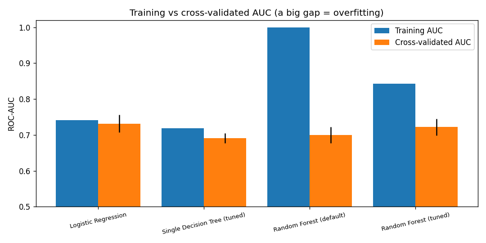
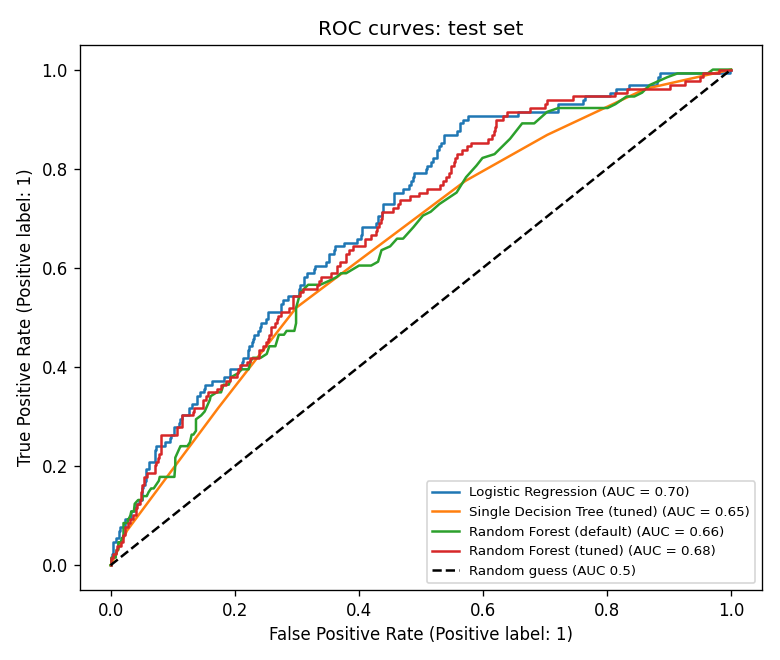
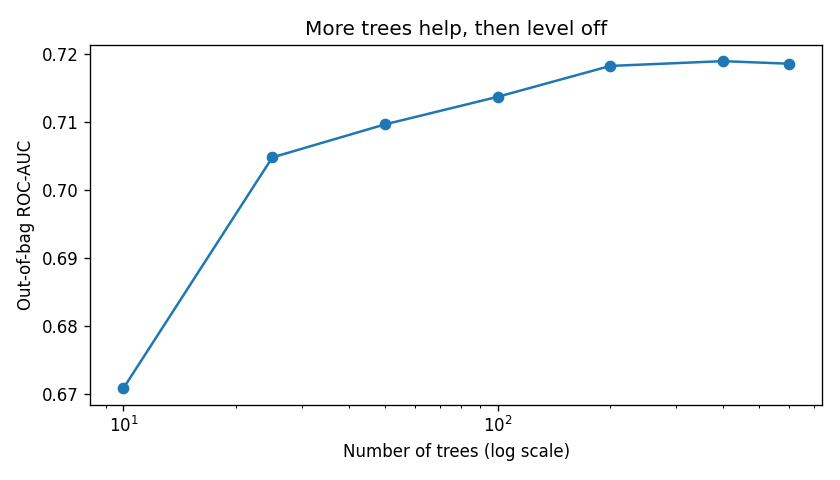
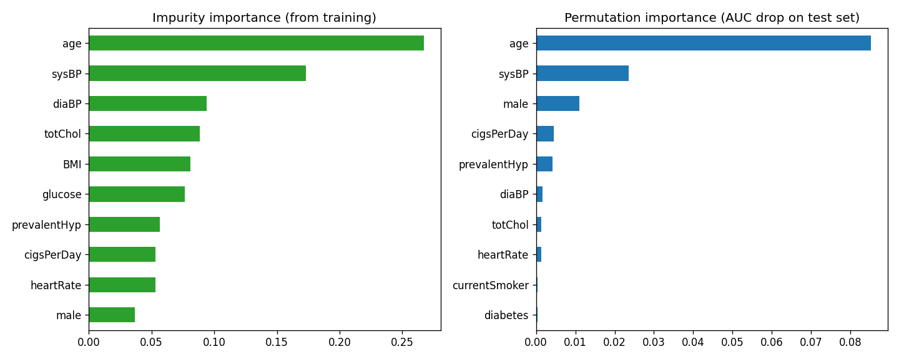

# 🌲 Random Forest: Heart Disease Risk (Forest vs. Tree vs. Logistic Regression)

  

Predicts 10-year **coronary heart disease (CHD)** risk on the Framingham Heart Study data, and runs a fair head-to-head comparison: **does a forest of hundreds of trees beat a single decision tree, and does it beat the simple [Logistic Regression](../Logistic%20regression/) model?** The app shows how many trees in the forest vote "higher risk" for each person.

## 🧠 How a Random Forest works (plain English)

A single decision tree is easy to read, but it's **unstable**: change a few training rows and you can get a completely different tree. A random forest fixes this with the **wisdom of crowds**:

1. **Bootstrap**: each tree is trained on a random sample of patients (drawn *with replacement*, so some patients appear twice and about 37% are left out).
2. **Random features**: at every split, a tree may only consider a random subset of the features. This forces the trees to be *different* from each other.
3. **Vote**: for a new patient, every tree makes a prediction and the forest averages them.

Individual trees make different mistakes, so averaging cancels much of the noise. A bonus: the ~37% of patients each tree *didn't* see give a free validation score, the **out-of-bag (OOB)** score.

| Setting | What it controls |
|---|---|
| `n_estimators` | Number of trees (more = more stable, slower) |
| `max_depth`, `min_samples_leaf` | How big each tree can grow (limits overfitting) |
| `max_features` | How many features each split may consider (more = trees look more alike) |
| `class_weight` | Gives the rare CHD class more weight |

## 📂 Dataset

**Framingham Heart Study** ([`../datasets/framingham.csv`](../datasets/)): 4,238 people, 14 features (age, sex, smoking, blood pressure, cholesterol, BMI, glucose, …). **15.2%** developed CHD within 10 years.

## ⚙️ Approach (`train.py`)

- Stratified 80/20 split; missing values are filled *inside* each pipeline with training-fold medians (no leakage).
- All models use **balanced class weights** because of the 15% / 85% imbalance.
- **Four models compared** with 5-fold stratified cross-validation (ROC-AUC):
  1. Logistic Regression (the baseline from the previous project)
  2. A single Decision Tree, tuned with `GridSearchCV`
  3. A Random Forest with default settings (300 fully grown trees)
  4. A **tuned Random Forest**: `RandomizedSearchCV` over 25 combinations of trees, depth, leaf size and features per split
- **OOB curve**: how many trees are enough?
- **Two kinds of feature importance**: impurity-based (from training) and permutation-based (how much test AUC drops when a feature is shuffled).

## 📊 Results (test set: 848 people)

| Model | CV AUC | Train AUC | Test AUC | Recall | Precision | F1 |
|---|---|---|---|---|---|---|
| **Logistic Regression** | **0.732 ± 0.025** | 0.742 | **0.699** | **58.1%** | 24.8% | **0.347** |
| Single Decision Tree (depth 3) | 0.691 ± 0.014 | 0.718 | 0.647 | 62.0% | 21.5% | 0.319 |
| Random Forest (default) | 0.700 ± 0.022 | **1.000** | 0.656 | 1.6% | 28.6% | 0.029 |
| Random Forest (tuned) | 0.722 ± 0.023 | 0.842 | 0.681 | 47.3% | 24.7% | 0.324 |

Tuned forest: 200 trees, `max_depth=8`, `min_samples_leaf=20`, `max_features="sqrt"`.



**What the results mean (three lessons):**

1. **A forest beats a single tree.** CV AUC rises from 0.691 to 0.722, because averaging many trees smooths out each tree's mistakes.
2. **The default forest overfits badly.** Fully grown trees memorise the training patients (training AUC **1.000**). Class weights can't help a tree whose leaves each hold a single patient, so at the 0.5 threshold it flags almost nobody (1.6% recall). Limiting depth and leaf size closes most of that gap.
3. **Logistic Regression still wins here.** Heart disease risk in this data is mostly *additive*: each risk factor adds a bit more risk. A linear model captures that directly, while trees have to approximate smooth effects with many small steps. **More complex is not automatically better.** Always compare against a simple baseline.





OOB AUC climbs quickly up to about 100 trees, then levels off at about 0.72. Beyond 200 trees you mostly pay in training time.



Both methods agree that **age** matters most, followed by **systolic blood pressure** and **sex**. Impurity importance also ranks continuous features like cholesterol and BMI highly, because they offer many possible split points. Permutation importance (measured on unseen test data) is the more reliable view.

## 🖥️ App (`app.py`)

Enter a person's details to get:

- a **risk label** and a 0–100 **risk score**
- the **forest's vote**, e.g. "196 of 200 trees vote 'higher risk'", which shows the ensemble idea directly

## 🚀 Run it

```bash
pip install -r requirements.txt
python train.py          # compare 4 models, OOB curve, importances (~2 min)
python app.py            # open http://127.0.0.1:7860
python -m unittest -v    # 6 tests (~3 min)
```

## 📚 Key takeaways

- Random forests reduce the **instability** of single trees by averaging many decorrelated trees.
- Default forests can still **overfit**: tune depth and leaf size, and watch the train-vs-CV gap.
- The **OOB score** is a free validation check built into random forests.
- Prefer **permutation importance** over impurity importance when explaining a model.
- On simple, additive problems, **logistic regression can beat a forest**. Pick the model the data needs.

⚠️ Educational project only, not medical advice.
