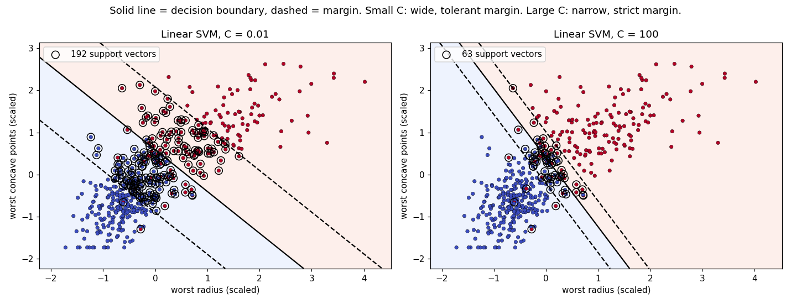
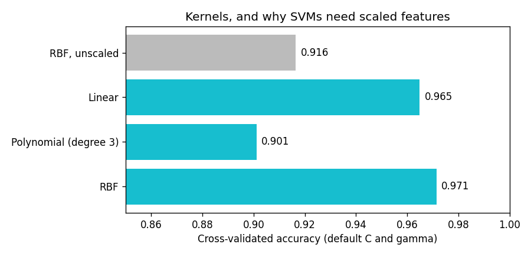
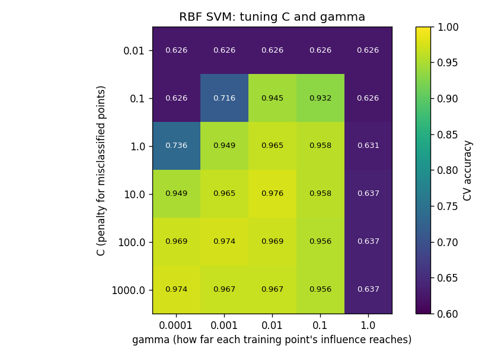
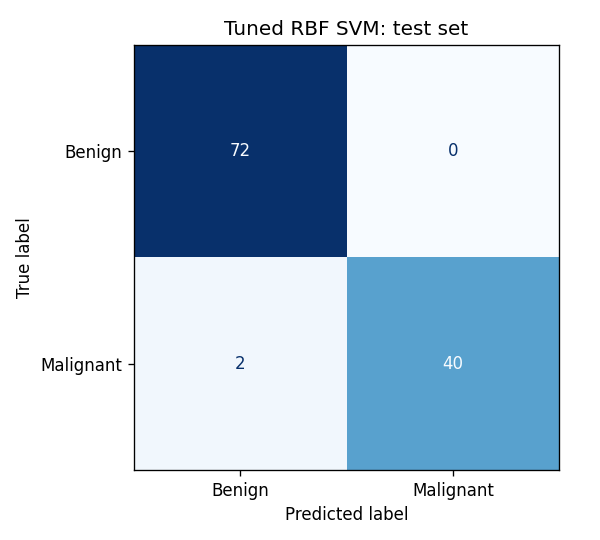

# 🎗️ Support Vector Machine: Breast Cancer Diagnosis

  

Classifies breast tumours as **malignant** or **benign** from 30 measurements of cell nuclei in a biopsy image. The project compares SVM kernels, shows why scaling matters, tunes `C` and `gamma` with a heatmap, and visualises the **maximum margin** idea. On held-out patients, the tuned SVM is **98.2% accurate with zero false alarms**.

## 🧠 How an SVM works (plain English)

Imagine benign and malignant tumours as two groups of dots. Many lines could separate them. An SVM picks the line with the **widest possible gap** (the *margin*) between the two groups, like building the widest road between two neighbourhoods.

- The points sitting on the edge of the road are the **support vectors**. They alone define the boundary; every other point could move without changing it.
- **`C` (softness):** real data overlaps, so some points must end up on the wrong side. A **small C** allows more violations and gives a wide, tolerant margin. A **large C** punishes violations and gives a narrow margin that bends to fit every point.
- **The kernel trick:** when no straight line works, a kernel lets the SVM draw curved boundaries by implicitly mapping the data into a higher-dimensional space.
  - `linear`: a straight boundary
  - `poly`: polynomial curves
  - `rbf` (radial basis function): flexible, blob-shaped regions. **`gamma`** sets how far each point's influence reaches (large gamma = very local, wiggly boundaries).



With `C = 0.01`, the margin is wide and **192** training points are support vectors. With `C = 100`, it narrows and only **63** are.

## 📂 Dataset

The **Wisconsin Diagnostic Breast Cancer** dataset, built into scikit-learn: **569 tumours** (212 malignant, 37%). Each has **30 features**: the mean, standard error and "worst" (largest) value of 10 nucleus properties, such as radius, texture, perimeter, area, smoothness, concavity and symmetry.

## ⚙️ Approach (`train.py`)

1. Stratified 80/20 split; malignant is the positive class (the one we must not miss).
2. **Kernel comparison** with 5-fold CV, including an *unscaled* RBF SVM to show the effect of scaling.
3. **Grid search** over 6 values of `C` × 5 values of `gamma` for the RBF kernel (30 combinations), saved as a heatmap.
4. Tuned **linear SVM** and **logistic regression** for comparison.
5. Test-set evaluation focused on **missed cancers** (false negatives) and **false alarms** (false positives).

## 📊 Results

**Kernels and scaling** (5-fold CV accuracy, default settings):

| Setup | CV accuracy |
|---|---|
| RBF, **unscaled** | 0.916 |
| Polynomial (degree 3) | 0.901 |
| Linear | 0.965 |
| **RBF (scaled)** | **0.971** |



Scaling adds about 5.5 points to the RBF SVM. Features like `worst area` (values in the thousands) would otherwise dominate the distance calculations, just as in [KNN](../K-nearest%20neighbors/).



The best region is **C = 10, gamma = 0.01** (CV accuracy 0.976). Very large gamma makes each point an island (overfitting), and very small C with small gamma makes the model too simple.

**Test set (114 patients, 42 malignant):**

| Model | Accuracy | Recall (malignant) | Precision | ROC-AUC | Missed cancers | False alarms |
|---|---|---|---|---|---|---|
| **SVM, RBF (C=10, γ=0.01)** | **98.2%** | **95.2%** | **100%** | 0.996 | **2** | **0** |
| SVM, linear (C=0.1) | 98.2% | 95.2% | 100% | 0.996 | 2 | 0 |
| Logistic Regression | 96.5% | 92.9% | 97.5% | 0.996 | 3 | 1 |



- The tuned SVM **never raised a false alarm** and missed 2 of 42 malignant tumours.
- **RBF and linear kernels perform identically**: once scaled, these classes are almost linearly separable, so the extra flexibility of RBF isn't needed. A linear SVM is simpler to explain.
- Only **56 of 455 training points (12%)** are support vectors. The rest of the training data doesn't affect the boundary at all.

## 🖥️ App (`app.py`)

1. Pick a **real patient from the held-out test set** (with their actual biopsy result).
2. Adjust **worst radius**, **worst concave points** and **worst texture**.
3. See the diagnosis, the **signed distance from the decision boundary** (how confident the SVM is), and a warning for borderline cases inside the margin.

The model uses all 30 measurements, so changing these three moves the distance but often won't flip the diagnosis by itself. For a benign patient, raising all three to malignant-like values moves the distance from −3.07 to +1.34. Related measurements (mean radius, area, perimeter) still carry the original signal, which is a good illustration of **correlated features**.

## 🚀 Run it

```bash
pip install -r requirements.txt
python train.py          # kernels, grid search, charts (~5 s)
python app.py            # open http://127.0.0.1:7860
python -m unittest -v    # 5 tests
```

## 📚 Key takeaways

- SVMs find the **maximum-margin** boundary, and only the **support vectors** define it.
- **`C`** trades margin width against training errors; **`gamma`** controls how local an RBF kernel is. Tune them together.
- SVMs are distance-based, so **always scale** the features.
- Try the **linear kernel first**: if it matches RBF, prefer the simpler model.

⚠️ Educational project only, not medical advice.
